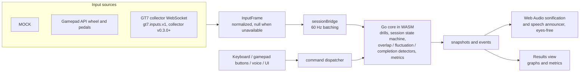

<div align="center">

<h1>Trail Braking Trainer</h1>
<p>Browser-based muscle-memory trainer for precise, smooth, repeatable brake, steering and throttle input.</p>

[](https://trail-braking-trainer.aru.sh)
[](https://github.com/arush-sal/trail-braking-trainer/actions/workflows/test.yml)
[](https://github.com/arush-sal/trail-braking-trainer/actions/workflows/security.yml)
[](https://github.com/arush-sal/trail-braking-trainer/actions/workflows/codeql.yml)
[](https://github.com/arush-sal/trail-braking-trainer/actions/workflows/release.yml)
[](core/go.mod)
[](.node-version)
[](LICENSE)

<a href="https://trail-braking-trainer.aru.sh">Live site</a> &middot;
<a href="#try-it">Try it</a> &middot;
<a href="#how-it-works">How it works</a> &middot;
<a href="#status">Status</a> &middot;
<a href="#supported-and-unsupported-paths">Supported paths</a> &middot;
<a href="#developer-quickstart">Developer quickstart</a> &middot;
<a href="#using-the-app">Using the app</a> &middot;
<a href="#known-limitations">Known limitations</a> &middot;
<a href="#verifying-a-release">Verify a release</a> &middot;
<a href="#faq">FAQ</a> &middot;
<a href="#license">License</a>

</div>

A browser-based trainer for brake, steering and throttle control. It gives
eyes-free audio and speech feedback while you drill holds, sweeps and
progressions, then shows accuracy, smoothness, timing and consistency
results. It is not a racing-line advisor, lap-time optimizer, or race
engineer. Spec: `trail-braking-trainer-implementation-plan.md`.

## Try it

Open <https://trail-braking-trainer.aru.sh> and choose the MOCK input source
to try the drills without any hardware. Use desktop Chrome or Edge for
gamepad and speech features. Releases:
<https://github.com/arush-sal/trail-braking-trainer/releases>.

## How it works



## Status

**Released and live ([latest release](https://github.com/arush-sal/trail-braking-trainer/releases/latest)), but still verified
only against MOCK input (hardware tests pending).**
Nothing here is verified on real wheels, pedals or GT7, or by a person listening in a real
browser, until the final manual run is recorded in `docs/validation-log.md`.

| Area | State |
|---|---|
| Input | MOCK source, plus a Gamepad adapter with diagnostics and optional calibration (**not verified on any wheel yet**). |
| Fanatec / Logitech / DualSense | Not tested. Follow `docs/hardware-test-protocol.md`. |
| Go core | Drills, targets, session state machine, overlap/fluctuation/completion/primary detectors, metrics. WASM session API v1 (ADR 0007). |
| Audio + speech | Sonification of position, movement and smoothness (dual tone / deviation / self-paced end-state), alerts, spoken cues with ducking. Sounds are PROPOSED: no listening test yet, and browser speech output is unverified. |
| Commands | One dispatcher for keyboard, learned gamepad buttons, voice (browser SpeechRecognition, privacy notice) and UI. Voice and gamepad buttons are unverified. |
| Sessions | Freeform and guided (preset catalog, plus a parameter drill editor with core-validated preview), rounds/rest/countdown, source-loss handling. MOCK sessions of every drill type complete in e2e. |
| Metrics, graphs | Separate accuracy / smoothness / timing / consistency metrics (no combined score; formulas in `docs/metric-definitions.md`), desired-vs-actual graphs per channel, suggestions applied only on confirm. Thresholds are PROPOSED. Results stay in memory only. |
| GT7 collector WebSocket | Consumes `gt7.inputs.v1` from gt7-telemetry-collector v0.3.0+ (ADR 0011). Tested against the collector's contract fixtures and a MOCK server only; **not yet verified with a live PS5 from this app**. **GT7 steering is unavailable.** |
| Security, privacy, errors | CSP and security headers (`apps/web/public/_headers`), threat model and privacy review (`docs/security.md`), and a recovery path for every spec 8 failure. The production site loads Cloudflare Web Analytics (cookieless page-load metrics, no session data; ADR 0009). |
| Release, SBOM, signing, deploy | Tag-driven release workflow: reproducible tarball, Syft SBOMs, Cosign + GitHub attestations, GitHub Release (`docs/release-process.md`). Deploy: Cloudflare Workers Static Assets via the `cf` CLI at `trail-braking-trainer.aru.sh` (ADR 0008). Every release since v0.1.0 is deployed through this pipeline. |

Per-requirement status: `docs/requirements.md`. Hardware evidence:
`docs/validation-log.md`.

## Supported and unsupported paths

| Path | Status |
|---|---|
| MOCK input, all drills, audio, results | Works in automated tests (headless Chromium baseline; Firefox/WebKit in the CI matrix). |
| Gamepad API wheels and pedals (Chrome/Edge/Firefox) | Implemented, **unverified on hardware**. Browsers expose a device only after you press a pedal or button on the page. |
| Separate pedal and wheel devices | Supported by per-control device mapping. Unverified. |
| GT7 brake and throttle via the collector | Run `gt7-collector --ps5=<ps5-ip> --rtps=none --ws-listen=127.0.0.1:8765 --ws-origin=<page origin>` (v0.3.0+), then connect from the GT7 panel. Unverified with a live PS5 from this app. |
| GT7 steering | **Unavailable.** Evidence is inconclusive (`docs/research/gt7-steering-evidence.md`). The trainer never substitutes wheel angle or yaw. |
| Spoken output | Uses local speech voices by default. Network voices (which may send spoken text, including your results, to the browser vendor) are used only after you explicitly allow them in Controls. |
| Voice commands | Only where the browser has SpeechRecognition (not Firefox). The browser may process audio remotely. Keys and buttons always work. |
| Hidden or background tab | Not supported. Input and audio may be throttled. Keep the tab visible. |
| HTTPS page to `ws://` collector | Browser-dependent (Chrome/Edge show a local-network permission prompt; Firefox normally allows loopback; Safari likely blocks and needs `wss://`). Untested; see `docs/input-protocol.md`. |
| Offline use | Not supported. There is no service worker, by design. |

## Developer quickstart

Requires Go (version in `core/go.mod`) and Node (version in `.node-version`). `make lint`
and `make security` also need golangci-lint, govulncheck, osv-scanner, trivy and zizmor on
`PATH`.

```sh
make setup   # npm ci + go mod download/verify
make test    # Go (race) + Vitest
make lint    # go vet (native + js/wasm), golangci-lint, eslint, tsc
make build   # WASM + Vite bundle -> apps/web/dist
make dev     # Vite dev server
make test-wasm  # contract fixtures through built core.wasm
make test-e2e   # Playwright e2e (incl. CSP + error-recovery specs) against built bundles
make package VERSION=0.1.0  # SBOMs (syft) + reproducible tarball + checksums -> dist-release/
make verify-dist VERSION=0.1.0
```

`make dev` serves the app at <http://localhost:5173>. Use a desktop Chrome or Edge for
gamepad and speech features.

## Using the app

1. **Pick a source.** Choose MOCK (synthetic, labelled), Gamepad / wheel, or GT7 collector.
2. **Audio check.** Click **Enable session audio**. Browsers need a click before they play
   sound. Use **Audio check** for a test tone and volume. Headphones are recommended but not
   required, and the default gain is conservative.
3. **Map devices** (Gamepad). Press a pedal so the browser shows the device. Then click
   **Detect Brake / Steering / Throttle control** and move that control. Invert, deadzone,
   range capture and steering centre are optional. **Copy diagnostics report** helps with
   bug reports.
4. **Controls.** Default keys are G start, Space pause/resume, Enter complete round, S skip,
   Escape stop. You can rebind them, or learn wheel or controller buttons. Training inputs
   cannot be bound as command buttons. Voice commands are opt-in, after you read the privacy
   notice. Say "stop" twice to stop.
5. **Choose a drill.** Freeform gives continuous feedback for B, S, T, B+S, S+T or B+S+T.
   B+T is not allowed. Guided offers presets (hold, sweep, progressive, multi-stage; timed or
   self-paced) or custom parameters, with dual-tone or deviation audio and optional
   fluctuation alerts. You also set rounds (default 8), rest and countdown.
6. **Train eyes-free.** Start with the button, G, or voice. Rounds advance automatically.
   Brake+throttle overlap plays a warning and the round continues. If the source is lost,
   you hear an alert and the round is invalidated, never scored.
7. **Review results.** You get accuracy, smoothness, timing and consistency per round and for
   the session (no overall score), plus desired-vs-actual graphs per channel. Suggestions
   apply to the next session only if you confirm them. Results are gone on reload.

When something fails (no gamepad, microphone denied, audio suspended, collector unreachable,
missing steering, core not loading, slow input, files not loading), the app says what
happened and what to do. The full list is in `docs/security.md`, "Error recovery paths".

## Known limitations

- No hardware, listening or real-browser evidence yet. All sound mappings, thresholds and
  presets are PROPOSED.
- GT7: steering unavailable. Brake/throttle via collector v0.3.0 are unverified with a live PS5, an HTTPS page, LAN/`wss://` and Safari.
- Background tabs are unsupported, and there is no native adapter.
- Voice recognition depends on the browser and may be remote. It is not available offline.
- There is no history, export or saved settings. Mappings and bindings reset on reload.
- Slow-input warning threshold (20 Hz) and source-loss timeout (250 ms) are PROPOSED.
- Headless Firefox on the dev host ran MOCK input slowly (~18 Hz). Real Firefox is unmeasured.

## FAQ

**Do I need a wheel or GT7?** No. The MOCK source runs every drill with
synthetic input.

**Does it store my data?** No. Results stay in memory only and are gone on
reload. The production site loads Cloudflare Web Analytics (cookieless
page-load metrics, no session data; ADR 0009).

**Why is there no GT7 steering?** The evidence is inconclusive
(`docs/research/gt7-steering-evidence.md`). The trainer never substitutes
wheel angle or yaw for it.

**Which browsers work?** Chromium is the baseline, and Firefox and WebKit run
in the CI matrix. Voice commands need the browser's SpeechRecognition, so they
are not available in Firefox.

**Is it a racing-line or lap-time tool?** No. It trains input precision and
smoothness only.

## Verifying a release

Download every asset of Release `vX.Y.Z` into one directory, then (needs
`sha256sum`, [cosign](https://github.com/sigstore/cosign) v3, `gh`, `jq`, GNU tar):

```sh
scripts/verify-release.sh X.Y.Z path/to/assets
```

or by hand (the same checks; `V` is the version without `v`):

```sh
V=X.Y.Z
R=arush-sal/trail-braking-trainer
sha256sum --strict -c checksums.txt   # confirm it lists all three files below
for f in trail-braking-trainer_${V}_web.tar.gz trail-braking-trainer_${V}_web.spdx.json \
         trail-braking-trainer_${V}_source.spdx.json checksums.txt; do
  cosign verify-blob --bundle "$f.sigstore.json" \
    --certificate-identity "https://github.com/$R/.github/workflows/release.yml@refs/tags/v$V" \
    --certificate-oidc-issuer https://token.actions.githubusercontent.com "$f"
done
A=(--repo "$R" --signer-workflow "$R/.github/workflows/release.yml" --source-ref "refs/tags/v$V")
for f in trail-braking-trainer_${V}_web.tar.gz trail-braking-trainer_${V}_web.spdx.json \
         trail-braking-trainer_${V}_source.spdx.json; do
  gh attestation verify "$f" "${A[@]}"
done
gh attestation verify trail-braking-trainer_${V}_web.tar.gz "${A[@]}" \
  --predicate-type https://spdx.dev/Document/v2.3
```

The tarball's `build-manifest.json` lists version, commit, build time and the
sha256 of every bundle file. Details: `docs/release-process.md`.

## License

Business Source License 1.1. See [`LICENSE`](LICENSE).

| Parameter | Value |
|---|---|
| Change Date | 2030-01-01 |
| Change License | GNU GPLv3 |
| Additional Use Grant | None |
