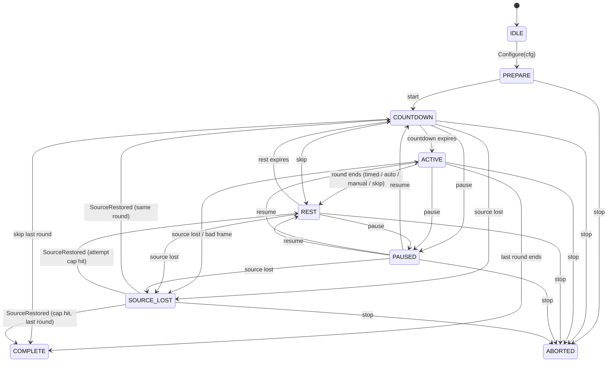

# Session lifecycle (`core/session`)

Implements spec 3.5 and 4.4 (R-016, R-017, R-019, R-020, R-027, R-029).
Pure Go, deterministic: no wall clock, timers or goroutines. Time is
injected as monotonic milliseconds (`performance.now()` on the TS side).
The authoritative table is `session.Transitions`; tests and the fuzzer
assert every emitted `stateChanged` event is in it.

`Reset()` returns any state to IDLE and discards config, clock and all
attempts (no leakage between sessions, R-027). COMPLETE and ABORTED are
terminal until reset.

## API

| Call | Purpose |
|---|---|
| `New()`, `Reset()` | IDLE session / discard everything |
| `Configure(cfg)` | IDLE -> PREPARE after `cfg.Validate()` |
| `Dispatch(cmd, nowMs)` | the single command dispatcher |
| `Tick(nowMs)` | advance clock, fire expired timers |
| `Observe(frame)` | feed a frame; `frame.ReceivedMonoMs` is the clock |
| `SourceLost(nowMs)`, `SourceRestored(nowMs)` | explicit source state |
| `State()`, `RoundsDone()`, `Attempts()` | read-only views (`Attempts` is a copy) |
| `ActiveElapsedMs(nowMs)` | unpaused ACTIVE time of the open attempt (frozen while paused); read-only, fires no timers |

Every mutating call returns the `[]Event` it produced, ordered by `atMs`.

## Commands (valid states)

| Command | Valid in | Effect |
|---|---|---|
| `start` | PREPARE | round 1 countdown |
| `pause` | COUNTDOWN, ACTIVE, REST | freeze phase timer |
| `resume` | PAUSED | back to the paused phase |
| `completeRound` | ACTIVE, self-paced `manual`/`either` | outcome `completedManual` |
| `skipRound` | COUNTDOWN, ACTIVE | outcome `skipped` (consumes the round, never a valid attempt) |
| `stop` | PREPARE, COUNTDOWN, ACTIVE, REST, PAUSED, SOURCE_LOST | ABORTED; open attempt -> `aborted` |

An invalid command, unknown command, invalid frame or bad time returns an
error and changes nothing: the call is applied to a snapshot that is rolled
back on error, including any timer expiry the call's time would have fired.

## Time

- All calls share one clock. A time that is NaN, infinite, negative or
  earlier than the last accepted time is rejected with `ErrTime`. Equal
  times are allowed.
- Phase timers are computed, never chained: `end = phaseStart +
  pausedTotal + duration`. Transitions are stamped with the scheduled `end`,
  not the (possibly late) call time, so a late or throttled tick yields the
  same timeline as fine-grained ticks (tested).
- Pause time is excluded from countdown, active and rest durations. Pauses
  during ACTIVE are recorded on the attempt as `paused` intervals.
- **Bridge requirement (Phase 3):** strict monotonic time is kept on
  purpose. The TS bridge must deliver frames in timestamp order, and before
  any `Tick` of a later time; a frame older than the last accepted time is
  rejected with `ErrTime`. Implemented: `sessionBridge.ts` flushes buffered
  frames (`observe`) before every `tick`/`command`, and `core/api` drops and
  counts (`outOfOrder`) any frame that is still late instead of failing the
  batch. `api.Runner.Start` builds a new session and fresh completion,
  overlap, fluctuation and primary detectors every time (ADR 0007).
- Countdown emits `countdown` events with `remaining` = 3, 2, 1 (whole
  seconds, `ceil(countdownMs/1000)` first) for speech.

## Rounds

- Rounds advance automatically after rest. The trainer never waits for
  inputs to return to a start state (R-020). The round starts when the
  countdown expires regardless of input; the first ACTIVE frame
  (`frames[0]`) is the initial-offset record for metrics.
- Timed: completes after `roundDurationMs` of active (unpaused) time,
  only with valid input coverage up to the end (see source loss policy).
- Self-paced (`completion`): `auto` via `AutoComplete`, a `Completion`
  interface (`Observe(frame) bool`, `Reset()`; `engine.CompletionDetector`
  satisfies it). Only ACTIVE frames are passed; hold time and hysteresis
  are the detector's job. The session calls `Reset()` at the start of every
  attempt, on pause, on resume and on source loss, so each round (and each
  retry) needs its own full hold and paused time never counts toward it
  (tested with the real engine detector). The engine must still hand each
  new session a fresh or reset detector, since `Session.Reset` drops the
  config without calling it. `manual` via `completeRound`, `either` both.
  Endpoint error of a manual
  completion is computed later by metrics from the frames.
- A skip from COUNTDOWN records a zero-length `skipped` attempt. Skip and
  completion both go to REST, or COMPLETE after the last round.

## Source loss policy (spec 4.4, R-029)

- **Silence rule (in-core, not only a browser watchdog):** during ACTIVE,
  more than `maxFrameGapMs` of unpaused time without a valid frame (since
  the previous valid frame, or the attempt start) ends the attempt as
  `invalidSourceLost`, stamped exactly at `lastValid + maxFrameGapMs`.
  It fires from `Tick`, a command, or the next frame, whichever comes
  first; the stamp is the same either way. Paused time does not count.
- **Timed completion needs coverage:** a timed round only ends
  `completedTimed` if that silence deadline is not before the scheduled end
  (`end - lastValid <= maxFrameGapMs`). A frame stamped exactly at the end
  belongs to the round and is checked before the round ends, so a
  gap/stale/missing-required-axis frame at the end invalidates it. The
  end timestamp stays exact; there is no grace period, so the decision is
  deterministic and needs no frame after the end. Fuzz invariant: no
  `completedTimed` attempt has an unpaused frame hole > `maxFrameGapMs`.

- During ACTIVE, a frame with `quality.gap` or `quality.stale`, or with any
  `requiredAxes` channel unavailable, or an explicit `SourceLost` call ends
  the attempt as `invalidSourceLost` (the offending frame is kept as
  evidence) and enters SOURCE_LOST. It is never scored as success and does
  not consume the round.
- `SourceLost` is also accepted in COUNTDOWN, REST and PAUSED so rounds do
  not roll on without a source. Frames outside ACTIVE are ignored.
- While SOURCE_LOST, timers are frozen and frames are ignored.
  `SourceRestored` goes to COUNTDOWN for a fresh attempt at the **same**
  round number. The invalid attempt stays in `Attempts()`; nothing is
  overwritten or extrapolated.
- Attempt cap: once a round has `maxAttemptsPerRound` `invalidSourceLost`
  attempts, `SourceRestored` uses the round up (counted in `RoundsDone()`,
  but neither completed nor skipped; its last outcome is
  `invalidSourceLost`) and proceeds to the next round: REST then COUNTDOWN,
  or COMPLETE after the last round. Attempts are therefore bounded by
  `rounds * maxAttemptsPerRound`.

## Recording and memory

Each attempt keeps round number, start/end ms, paused intervals, outcome and
the frames received while ACTIVE. At most `maxSamplesPerRound` frames are
kept (the first ones); later frames are dropped and `truncated` is set.
At most `MaxPausedIntervals` (256) pause intervals are kept per attempt;
later ones set `pausedTruncated`, while `pausedMs` stays the exact total.
Frames are deep-copied on ingestion and again by `Attempts()`, so neither
the caller's frame nor an exported attempt aliases recorded data.
Total memory is bounded by `rounds * maxAttemptsPerRound * maxSamplesPerRound`
frames.

A timed round cannot complete with a frame hole longer than
`maxFrameGapMs` (silence rule). Metrics (Phase 4) must still report low
sample coverage (e.g. truncated attempts) as N/A or invalid, never as
success. Implemented in `core/metrics` (coverage < 0.90 => N/A; only
completed attempts are scored), see docs/metric-definitions.md.

## Config (JSON camelCase)

| Field | Default | Rule |
|---|---|---|
| `rounds` | 8 (R-019) | 1..100 |
| `restMs` | 5000 (proposed) | 0..3600000 |
| `countdownMs` | 3000 (proposed) | 0..3600000 |
| `timing` | `timed` | `timed` or `selfPaced` |
| `roundDurationMs` | 10000 (placeholder) | timed: (0, 3600000]; selfPaced: must be 0 |
| `completion` | - | selfPaced: `auto`/`manual`/`either`; timed: empty |
| `requiredAxes` | none | subset of `brake`/`steering`/`throttle` |
| `maxSamplesPerRound` | 18000 (5 min at 60 Hz) | 1..216000 |
| `maxAttemptsPerRound` | 3 | 1..10 |
| `maxFrameGapMs` | 100 (proposed: 6 frames at 60 Hz) | (0, 3600000] |
| `AutoComplete` (Go only) | nil | required for `auto`/`either` |

## Events

`stateChanged` (from, to), `countdown` (round, remaining), `roundStarted`,
`roundEnded` (round, outcome: `completedTimed`, `completedAuto`,
`completedManual`, `skipped`, `invalidSourceLost`, `aborted`),
`sessionComplete`.
